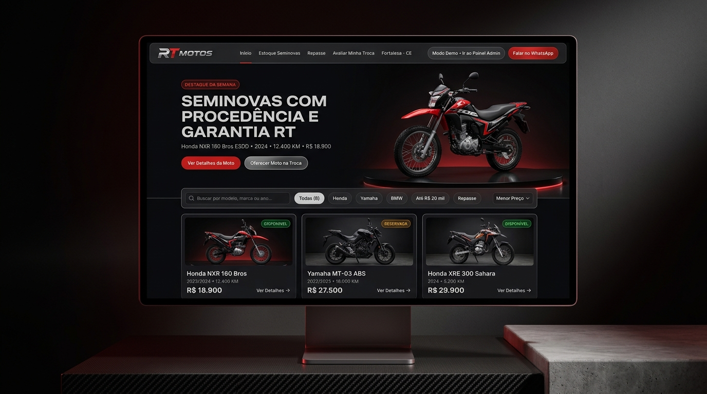
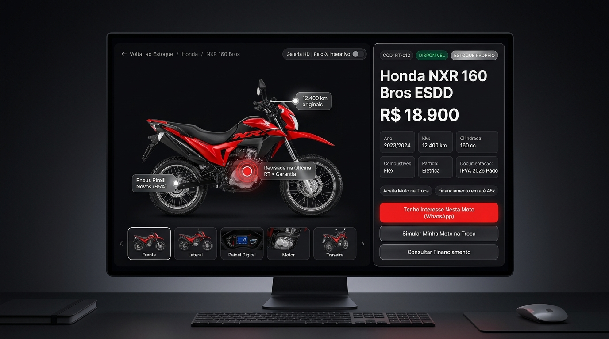
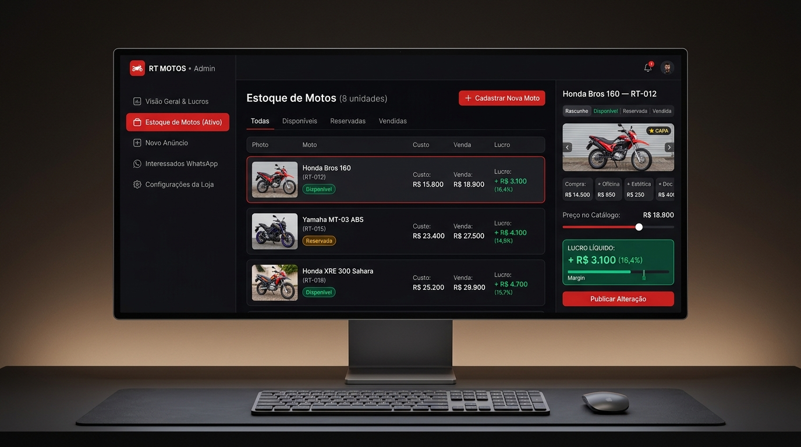
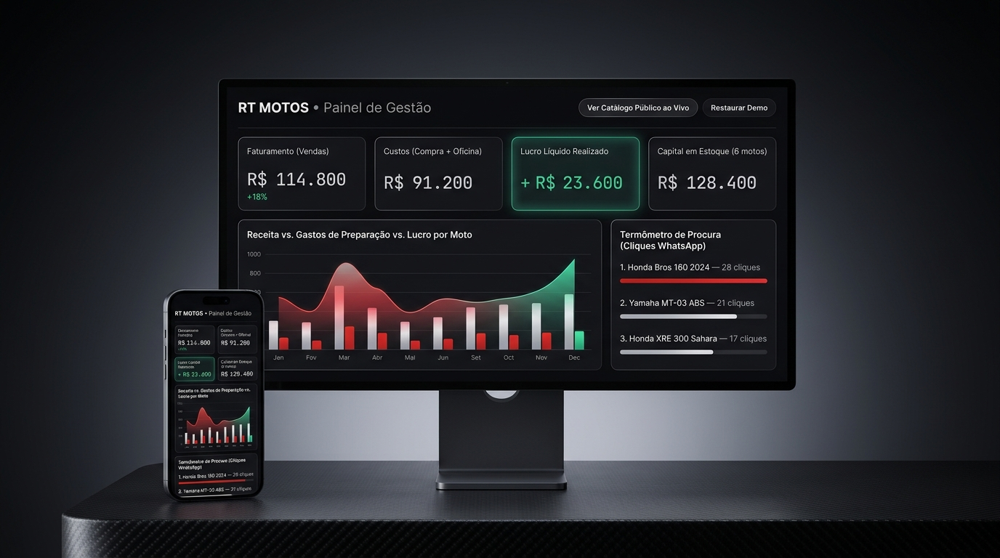

# 🏍️ RT Motos — Plataforma de Vitrine & Gestão Comercial de Motocicletas


A **RT Motos** é uma plataforma web moderna e de alta performance desenvolvida para lojas de motocicletas seminovas, repasses e veículos novos. A solução combina uma **vitrine pública imersiva de alta conversão** para clientes com um **painel de gestão administrativa e financeira (DRE)** completo, rápido e responsivo.

---

## 📸 Demonstração Visual & Identidade

A plataforma foi concebida com design automotivo escuro de alto contraste (*dark mode* nativo com acentos em vermelho rubi e prata metálico), inspirado nos painéis e mostradores HUD de motocicletas esportivas.

| Vitrine Pública (Desktop) | Detalhes com HUD & Raio-X |
| :---: | :---: |
|  |  |

| Estoque & Inspetor de Margem | Dashboard Financeiro (DRE) |
| :---: | :---: |
|  |  |

---

## ✨ Principais Funcionalidades

### 🌐 Vitrine Pública (Experiência do Comprador)
- **Catálogo Inteligente**: Pesquisa por texto em tempo real e filtros rápidos por marca (Honda, Yamaha, BMW, Kawasaki, etc.), faixa de cilindrada, preço, ano e status.
- **Apresentação em Destaque (Stage)**: Banner hero com rotação dinâmica das principais motos do inventário.
- **Página de Detalhes da Motocicleta**:
  - Mostrador de especificações técnicas completas em formato HUD (quilometragem, partida, freios, combustível, condição).
  - **Galeria Interativa com Raio-X**: Sistema exclusivo de **Hotspots** nas fotos que destaca componentes mecânicos e opcionais (escapamento esportivo, freios ABS, slider, iluminação LED, pneus novos).
  - Zoom interativo em tela cheia com navegação por gestos/teclado.
  - Veículos relacionados e recomendações inteligentes baseadas em preço e categoria.
- **Integração Comercial via WhatsApp**:
  - Geração automática de mensagens personalizadas incluindo código do veículo, modelo, ano, valor de referência e se há proposta de troca ou simulação de financiamento.

---

### 🛡️ Painel Administrativo (`/admin`)
- **Dashboard Financeiro & DRE**:
  - Acompanhamento em tempo real de faturamento bruto, custo total de aquisição/reparos, margem de contribuição (R$ e %), ticket médio e total de motos ativas vs. vendidas.
  - Gráfico evolutivo de receitas e histórico de vendas com comparativo de períodos.
- **Gestão de Estoque & Inspetor de Custos**:
  - Rastreamento individual do histórico de custos de cada moto: valor de aquisição, oficina/revisão, estética/polimento, documentação/transferência e outros.
  - **Termômetro de Lucro**: Indicador dinâmico em tempo real da margem de lucro projetada para orientar a equipe de vendas na negociação.
  - Registro simplificado de vendas (à vista, financiamento, com troca).
- **Assistente de Cadastro & Edição (Wizard em 4 Etapas)**:
  1. **Identificação**: Marca, modelo, versão, ano, placa/código interno, quilometragem e cilindrada.
  2. **Anúncio & Condições**: Preço de venda, aceitação de troca, financiamento, destaques e descrição comercial.
  3. **Custos & Margens**: Previsão de despesas e cálculo automático do ponto de equilíbrio.
  4. **Fotos & Hotspots**:
     - Upload de fotos reais com persistência local no IndexedDB.
     - Reordenação de fotos via Drag & Drop (`@dnd-kit`).
     - Editor visual de Hotspots para marcar pontos de inspeção na moto.
- **Gestão de Interessados & Leads**:
  - Rastreamento dos cliques e intenções de compra originados na vitrine (interesse direto, proposta de troca e simulação de parcelamento).
- **Sincronização Multi-Abas**:
  - Alterações feitas no painel refletem instantaneamente na vitrine aberta em outras abas sem necessidade de recarregar a página (`BroadcastChannel` + IndexedDB).

---

## 🛠️ Tecnologias Utilizadas

| Tecnologia | Finalidade |
| :--- | :--- |
| **[Next.js 16](https://nextjs.org/)** | Framework React com App Router, Turbopack e Server-Side Generation |
| **[React 19](https://react.dev/)** | Biblioteca base para componentes reativos modernos |
| **[TypeScript 6](https://www.typescriptlang.org/)** | Tipagem estática rigorosa para integridade e segurança de dados |
| **[Tailwind CSS v4](https://tailwindcss.com/)** | Estilização utilitária de alta velocidade com temas customizados |
| **[Motion](https://motion.dev/)** | Animações fluidas de transição, números animados e micro-interações |
| **[Radix UI](https://www.radix-ui.com/)** | Componentes acessíveis (Dialogs, Tabs, Switches, Modais WAI-ARIA) |
| **[Zustand](https://zustand-demo.pmnd.rs/)** | Gerenciamento de estado global leve e desacoplado |
| **[idb-keyval](https://github.com/jakearchibald/idb-keyval)** | Armazenamento no cliente via IndexedDB para fotos e dados da demo |
| **[Zod](https://zod.dev/)** | Validação declarativa de esquemas de dados e formulários |
| **[Recharts](https://recharts.org/)** | Gráficos visuais para relatórios financeiros do dashboard |
| **[Lucide React](https://lucide.dev/)** | Biblioteca de ícones modernos e consistentes |
| **[Sonner](https://sonner.emilkowal.ski/)** | Notificações toast elegantes com feedback instantâneo |
| **[Playwright](https://playwright.dev/)** | Testes de integração end-to-end e fluxos automatizados de usuário |
| **[Axe-core](https://www.deque.com/axe/)** | Auditoria e garantia de acessibilidade (a11y) |

---

## 📁 Estrutura do Projeto

```text
RT---Motos/
├── public/                       # Arquivos estáticos, fotos das motos e assets
│   └── motos/                    # Imagens de alta resolução e fotos recebidas
├── referencias-visuais/          # Mockups e telas de referência de design
├── src/
│   ├── app/                      # Rotas e páginas do Next.js (App Router)
│   │   ├── admin/                # Painel administrativo (/admin, /admin/motos, etc.)
│   │   ├── motos/[slug]/         # Página de detalhes dinâmica da motocicleta
│   │   ├── sobre/                # Página institucional da loja
│   │   ├── globals.css           # Variáveis de tema e estilos globais
│   │   ├── public.css            # Estilos específicos da vitrine pública
│   │   ├── admin.css             # Estilos do painel administrativo
│   │   └── page.tsx              # Página inicial (Home / Catálogo)
│   ├── components/               # Componentes reutilizáveis
│   │   ├── admin/                # Componentes exclusivos do painel administrativo
│   │   ├── public/               # Componentes da vitrine (cards, galeria, filtros)
│   │   ├── effects/              # Efeitos visuais (spotlight, border beam, ruído)
│   │   └── ui/                   # Primitivas de interface (botões, inputs, painéis)
│   └── lib/                      # Lógica de negócio, regras financeiras e dados
│       ├── catalog.ts            # Utilitários de pesquisa e filtros do catálogo
│       ├── finance.ts            # Fórmulas de DRE, lucro bruto e margens
│       ├── format.ts             # Formatadores de moeda (BRL), km e datas
│       ├── whatsapp.ts           # Montagem inteligente de links do WhatsApp
│       └── data/                 # Camada de dados, repositório, schemas e store
└── tests/                        # Suíte de testes automatizados e Lighthouse
```

---

## 🚀 Como Executar Localmente

### Pré-requisitos
- **Node.js** 20.x ou superior instalado
- Gerenciador de pacotes **npm**

### Passo a Passo

1. **Clone o repositório:**
   ```bash
   git clone https://github.com/CA10V1ANA/RT---Motos.git
   cd RT---Motos
   ```

2. **Instale as dependências:**
   ```bash
   npm install
   ```

3. **Configure as variáveis de ambiente:**
   Copie o arquivo de exemplo:
   ```bash
   cp .env.example .env.local
   ```
   *(No Windows PowerShell: `Copy-Item .env.example .env.local`)*

4. **Inicie o servidor de desenvolvimento:**
   ```bash
   npm run dev
   ```

5. **Acesse no navegador:**
   - **Vitrine Pública**: [http://localhost:3000](http://localhost:3000)
   - **Painel Administrativo**: [http://localhost:3000/admin](http://localhost:3000/admin)

---

## 🧪 Scripts & Testes Disponíveis

O projeto conta com comandos para verificação de tipos, testes unitários, testes de fluxo e auditoria:

| Comando | Descrição |
| :--- | :--- |
| `npm run dev` | Inicia o servidor de desenvolvimento com Turbopack |
| `npm run build` | Compila o projeto para produção com validação rigorosa |
| `npm run start` | Inicia o servidor Next.js em modo de produção |
| `npm run typecheck` | Executa o gerador de tipos do Next.js e o TypeScript compiler (`tsc --noEmit`) |
| `npm run lint` | Executa a verificação estática de código com ESLint |
| `npm run test` | Executa os testes unitários da camada de dados e regras financeiras |
| `npm run test:browser` | Executa os testes automatizados de navegação via Playwright |
| `npm run test:workflows` | Testa os fluxos completos de criação, edição e venda de motos |
| `npm run test:e2e` | Roda a suíte completa de apresentação de ponta a ponta |
| `npm run test:lighthouse` | Executa auditoria de performance, SEO e boas práticas com Lighthouse |

---

## ☁️ Deploy na Vercel

O projeto foi construído para deploy com **configuração zero** na **[Vercel](https://vercel.com/)**:

1. Acesse seu painel na **Vercel** e clique em **"Add New Project"**.
2. Conecte sua conta do GitHub e selecione o repositório **`RT---Motos`**.
3. O framework **Next.js** será detectado automaticamente.
4. *(Opcional)* Em **Environment Variables**, configure a chave `NEXT_PUBLIC_SITE_URL` com a URL final do seu domínio.
5. Clique em **"Deploy"**.

A Vercel criará automaticamente o ambiente de produção com SSL gratuito, otimização de imagens e deploy contínuo em cada commit na branch `main`.

---

## 📄 Licença

Este projeto é desenvolvido para fins comerciais e demonstrativos. Todos os direitos reservados.

---

Desenvolvido por **[Caio Viana](https://github.com/CA10V1ANA)**.
